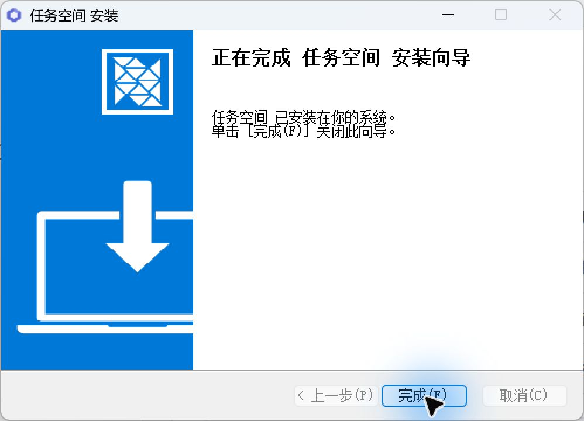
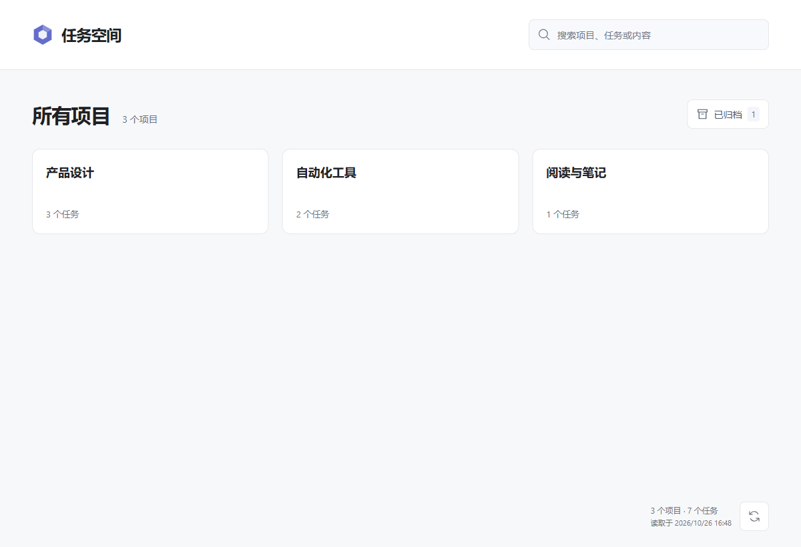
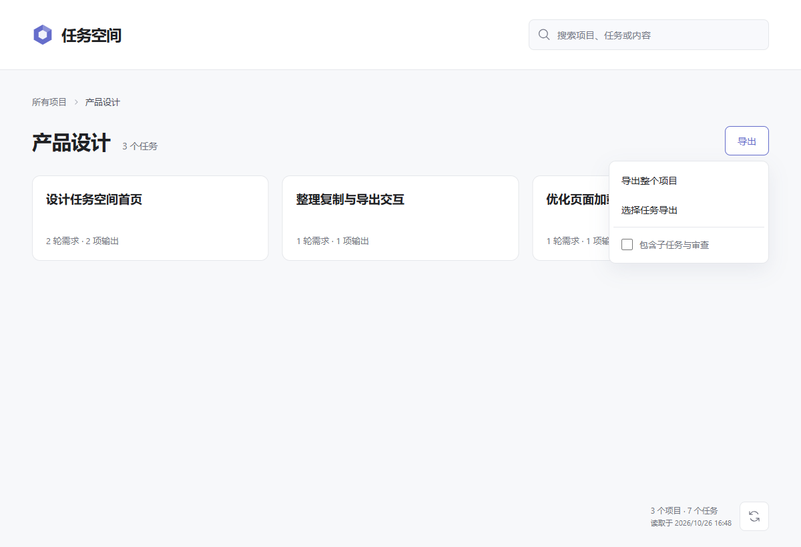
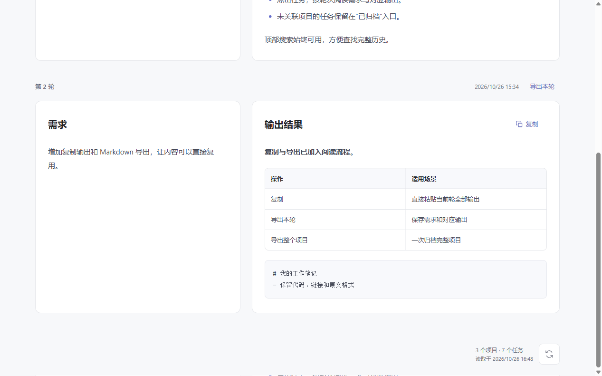
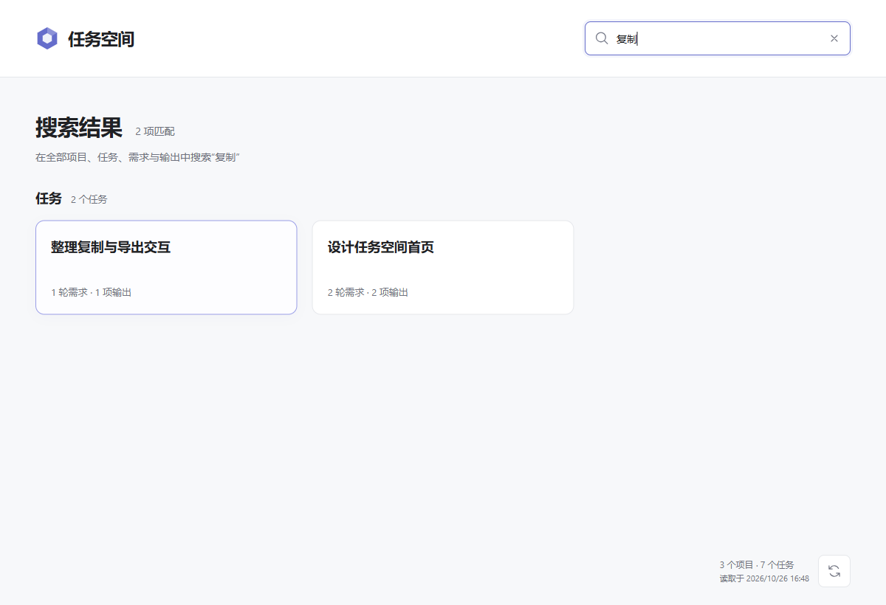
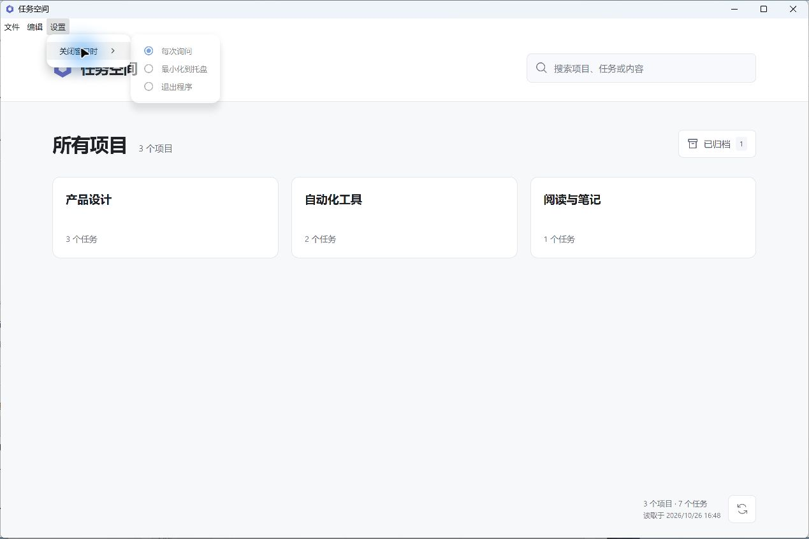

# 任务空间

在一个窗口里浏览本机 Codex 项目与对话，查找历史需求、复制回答，并导出 Markdown。

任务空间是独立的第三方工具，**非 OpenAI 官方产品**。它只读本机已有的 Codex 数据，读取与搜索在本机完成；不会创建、执行或编辑 Codex 任务，也不会把项目导入 Codex。

**版本 1.0（v1.0.0） · Windows 10 / 11 x64**

[下载桌面版](https://github.com/XueDing2DeMao/codex-task-workbench/releases/tag/v1.0.0) · [反馈问题](https://github.com/XueDing2DeMao/codex-task-workbench/issues)

## 1. 下载并启动

| 版本 | 下载 | 使用方式 |
| --- | --- | --- |
| 安装版 | [TaskSpace-1.0.0-Setup-x64.exe](https://github.com/XueDing2DeMao/codex-task-workbench/releases/download/v1.0.0/TaskSpace-1.0.0-Setup-x64.exe) | 双击安装包，按向导完成安装后启动 |
| 免安装版 | [TaskSpace-1.0.0-win-x64.zip](https://github.com/XueDing2DeMao/codex-task-workbench/releases/download/v1.0.0/TaskSpace-1.0.0-win-x64.zip) | **完整解压**到文件夹，再双击其中的 `任务空间.exe` |

两种版本都自带专用运行环境，**不需要安装 Node.js，不需要输入命令，也不需要手动导入文件**。

1. 先在这台电脑的 Codex 中创建或打开项目和对话，确保本机已有记录。
2. 安装桌面版，或完整解压免安装版。
3. 启动任务空间，程序会自动发现并读取当前用户的 Codex 数据。



> 本文截图均使用合成示例数据，不包含真实用户对话。

免安装版请保留整个解压目录，不要只复制 `任务空间.exe`，也不要直接在压缩包内运行。

本次发行包未进行代码签名，Windows 可能显示“未知发布者”。请核对下载来源；Release 中附有 `SHA256SUMS.txt`，可用于检查文件完整性。

## 2. 从项目找到对话

首页按项目展示卡片，卡片上的数量表示用户发起的主任务数。点击项目进入任务列表，再点击任务查看完整对话。



任务卡片显示任务名称、需求轮数与输出数量。详情按轮次排列，宽窗口中左侧是需求、右侧是对应输出；窄窗口自动改为单列。子任务与审查任务收在主任务下，展开即可阅读。



没有关联到当前项目的主任务集中在“已归档”入口。这里的“已归档”只是任务空间的展示分类，不会修改 Codex 中的归档状态。

读取项目、任务和搜索结果时会显示骨架扫光；读取正文时显示需求与输出骨架。系统开启“减少动态效果”后，骨架保持静态。

## 3. 复制回答，导出 Markdown

每轮“输出结果”旁的 **复制** 按钮会复制这一轮的全部输出原文，保留 Markdown、代码缩进与链接。复制成功后按钮显示“已复制”；没有输出的轮次不显示复制按钮。



| 想要保存什么 | 操作 |
| --- | --- |
| 当前一轮的需求与输出 | 点击该轮标题旁的 **导出本轮** |
| 一个项目的全部任务 | 项目页 **导出 → 导出整个项目** |
| 指定的一个或多个任务 | **导出 → 选择任务导出**，勾选任务后点击 **导出所选** |
| 项目中所有任务，包括尚未显示的卡片 | 在选择模式点击 **全选本项目**，再点击 **导出所选** |
| 主任务及其子任务、审查记录 | 在导出菜单勾选 **包含子任务与审查**，再选择导出范围 |

默认只导出主任务。“已归档”页面也支持全部导出与选择导出，展开的子任务同样支持“导出本轮”。

导出得到 `.md` 文件，按轮次保留原始需求与明确的最终输出，不受卡片分页或详情折叠影响。每轮采用 Callout 引用卡片，可用 Obsidian 或其他 Markdown 阅读器打开；**使用任务空间不需要安装 Obsidian**。导出不会打包图片或其他附件。若所选任务正文读取失败，程序会报告错误，不会悄悄漏掉该任务。

## 4. 搜索项目、任务和完整正文

在顶部搜索框输入关键词，即可查找项目名称、任务标题、完整需求与输出。搜索范围包含已归档任务和子任务，不局限于当前屏幕上的卡片。



- 可以输入中文片段，或用空格分隔多个关键词；英文搜索不区分大小写。
- 点击匹配的任务，可定位到相关轮次；命中子任务时会展开对应内容。
- 按 **Esc** 或点击清除按钮退出搜索。
- 在 Codex 中产生新记录后，可点击页脚刷新按钮立即重新检查数据。

## 5. 关闭窗口与托盘

首次点击窗口右上角 **X**，会询问 **最小化到托盘 / 退出程序 / 取消**。可以勾选 **记住我的选择**。



之后可通过顶部 **设置 → 关闭窗口时**，或托盘菜单中的 **关闭行为设置** 修改偏好，也可以恢复为 **每次询问**。最小化到托盘后，可从托盘恢复窗口；系统托盘不可用时会改为最小化到任务栏。

选择 **退出程序** 会停止任务空间自身启动的后台服务。

## 常见问题

**第一次打开没有项目或对话？**

任务空间读取的是这台电脑上已存在的 Codex 数据。请先在本机 Codex 中创建或打开项目与对话，再点击任务空间的刷新按钮。默认读取 `%USERPROFILE%\.codex`；设置了 `CODEX_HOME` 时，以该目录为准。仅登录账号并不代表旧电脑的本地记录已经迁移过来。

**换电脑后会自动同步旧对话吗？**

不会。安装包、ZIP 和项目源码都不包含你的历史记录。旧对话需要单独迁移对应的 Codex 源数据，并确认新电脑上的数据版本与路径可用；任务空间不会从旧电脑自动同步，也不会替 Codex 导入项目。

**会修改 Codex 数据或读取登录凭据吗？**

原始 Codex 数据以只读方式访问，不会覆写或迁移原始数据库，不读取 `auth.json`，也不会自动执行历史对话里的命令。应用自身的偏好与工作数据和原始 Codex 数据分开保存。

**为什么任务数量与所有线程数量不同？**

卡片统计的是用户发起的主任务。子任务和审查记录跟随主任务展示，不再重复计数；没有关联到当前项目的主任务可在“已归档”中查看。

**为什么有些轮次没有输出？**

页面只展示明确的最终输出，不会把过程说明、推理或工具日志当作最终结果。空任务、暂无最终输出和正文读取失败会分别提示。图片保留占位与文件名，不进行图片文字识别。

**支持哪些系统和 Codex 版本？**

本次桌面发行包面向 Windows 10 / 11 x64。Codex 数据读取适配已验证的原生存储结构；如果后续 Codex 更改数据格式，可能需要更新任务空间。遇到不兼容或读取失败时会明确报错，可在 [Issues](https://github.com/XueDing2DeMao/codex-task-workbench/issues) 中反馈错误信息，请勿公开上传含真实对话或凭据的数据库。

<details>
<summary>开发与源码启动</summary>

### 开发环境

需要 Node.js **24.13–24.x**。在仓库根目录执行：

```powershell
npm ci
npm run typecheck
npm run build
npm test
```

开发时运行 `npm start` 启动本机 API，再运行 `npm run dev` 启动页面开发服务。

### 构建桌面包

桌面工具与锁文件独立位于 `desktop/`。完成根目录依赖安装后，在 Windows x64 上执行：

```powershell
cd desktop
npm install
npm run build
```

构建脚本会先构建页面，再打包桌面外壳、应用资源与专用 Node.js。首次构建需要联网获取构建依赖和运行环境。普通用户直接下载发行包即可，无需执行这些命令。

### 通过脚本使用网页版

保留源码启动方式：将项目文件夹放到可写位置，双击 `Start-Workbench.cmd`。脚本自动准备环境、安装依赖、构建页面，并打开 <http://127.0.0.1:43127>；无需手动输入安装或导入命令。双击 `Stop-Workbench.cmd` 停止服务。

脚本优先复用系统 Node.js 24.13–24.x；没有合适版本时，从 [Node.js 官方发行站](https://nodejs.org/download/release/v24.13.0/) 下载固定版本 24.13.0，校验 SHA-256 后放入项目的 `.runtime/node/`。不会修改系统 Node.js、注册表或永久 PATH。首次准备需要联网，后续复用缓存；下载失败时可修复网络后重新双击。

桌面版无需运行上述网页版脚本。

### 代码与验证

- [`web/src/viewer/`](web/src/viewer/)：项目、任务、全文搜索、对话阅读与导出界面。
- [`server/native/`](server/native/)：只读目录、历史解析、内存搜索与 Markdown 导出。
- [`desktop/`](desktop/)：桌面窗口、托盘、独立后台服务与打包配置。
- [`tests/`](tests/) 和 [`web/tests/`](web/tests/)：服务、数据读取与页面逻辑验证。
- 原有接口说明见 [`server/API.md`](server/API.md)，历史导入格式边界见 [`server/history/README.md`](server/history/README.md)。

默认测试使用独立临时目录与合成数据。可选的本机样本验证仅在显式设置 `WORKBENCH_SAMPLE_MANIFEST` 时运行；未设置时跳过。仓库不包含真实用户对话、数据库或导出文件，README 图片也只使用合成示例。

</details>

<details>
<summary>数据读取与技术边界</summary>

- 数据源默认为当前用户的 `.codex`，可由 `CODEX_HOME` 指定。项目与线程来自 `state_5.sqlite`，明确归属参考 `.codex-global-state.json`，正文优先读取 `thread_history_1.sqlite`；SQLite 使用只读连接。
- 项目卡片以 Codex 当前项目表为准，缺少项目表的旧版本才回退到本机项目列表。任务按明确项目归属或当前项目工作目录匹配，子任务跟随主任务，不按标题或时间猜测父子关系。
- 正文按线程、轮次和消息身份配对，支持 JSONL / `.jsonl.zst` 日志回退；仅把明确的 `final` / `final_answer` 作为最终输出。图片 base64 不进入搜索。
- 全文索引只缓存在内存中。普通请求至多每 5 秒检查一次源文件变化，页脚刷新立即检查；没有定时执行对话的后台任务。
- 每次导出使用同一份内存快照并标注读取时间，文件由客户端下载，服务端不保存导出副本。原始 Markdown、代码缩进、表格与链接保留在 Callout 引用块中；不支持 Callout 的阅读器仍可作为普通引用块阅读。
- 桌面偏好默认位于 `%LOCALAPPDATA%\CodexTaskWorkbench\desktop-profile`，自身工作数据默认位于 `%LOCALAPPDATA%\CodexTaskWorkbench\desktop-data`。设置 `CTW_DATA_DIR` 可覆盖工作数据路径，桌面偏好随之存入该目录下的 `desktop-profile`。网页版默认使用 `%LOCALAPPDATA%\CodexTaskWorkbench`。
- 后台服务只监听本机回环地址，桌面版使用动态端口。退出桌面程序会停止其自身后台；不注册开机启动，也不迁移原有工作台数据。

</details>
